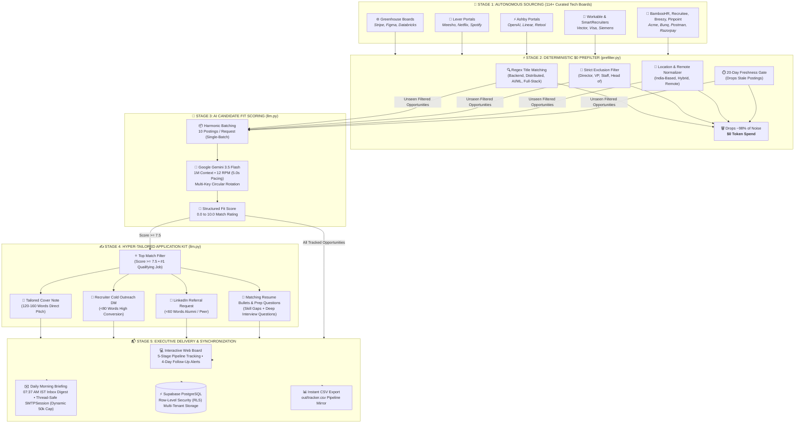
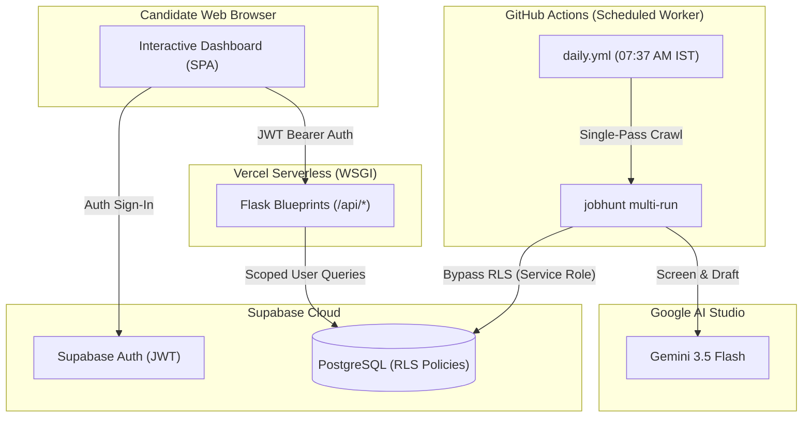

<p align="center">
  <a href="https://job-hunter-web-board.vercel.app">
    
  </a>
</p>

<h1 align="center">🎯 Job Hunter</h1>

<p align="center">
  <strong>Autonomous AI Career Intelligence Engine &amp; Real-Time Job Discovery Platform</strong><br>
  <em>Continuous multi-ATS radar scouting, deterministic $0 prefiltering, Google Gemini 3.5 Flash candidate fit scoring, tailored application kit drafting, and daily morning executive briefings.</em>
</p>

<p align="center">
  <a href="https://github.com/tanish-jain-225/job-hunter/releases/tag/v1.2.0"></a>
  <a href="https://job-hunter-web-board.vercel.app"></a>
  <a href="https://github.com/tanish-jain-225/job-hunter/actions/workflows/ci.yml"></a>
  <a href="tests/"></a>
  <a href="tests/"></a>
  <a href="https://python.org"></a>
  <a href="LICENSE"></a>
  <a href="https://github.com/astral-sh/ruff"></a>
  <a href="https://mypy-lang.org"></a>
</p>

<p align="center">
  <a href="https://job-hunter-web-board.vercel.app"><strong>Explore Web Board &raquo;</strong></a> &bull;
  <a href="RELEASE_NOTES.md"><strong>Release Notes (v1.2.0)</strong></a> &bull;
  <a href="CHANGELOG.md"><strong>Changelog</strong></a> &bull;
  <a href="docs/PRODUCT_ANALYSIS_WALKTHROUGH.md"><strong>Product Audit &amp; Valuation</strong></a> &bull;
  <a href="docs/GUIDE.md">Candidate Playbook</a> &bull;
  <a href="docs/SETUP.md">Setup Guide</a> &bull;
  <a href="docs/ARCHITECTURE.md">System Architecture</a> &bull;
  <a href="docs/API.md">REST API</a> &bull;
  <a href="docs/DEPLOYMENT.md">Cloud Deployment</a> &bull;
  <a href="docs/METRICS.md">Scaling &amp; Metrics</a>
</p>

---

### 🎨 Brand Identity & Logo Concept

> **The Job Hunter Reticle (🎯)**: The official brand mark portrays an autonomous targeting reticle and precision radar scanner. Rather than passively waiting for third-party recruiters to repost jobs, the reticle symbolizes **direct, active discovery**—probing company ATS backends at sub-second speeds, cutting through aggregate noise, and scoring candidate-role fit with cryptographic accuracy.

---

## ⚡ The 5-Stage Autonomous Execution Funnel

Job Hunter replaces dozens of hours of manual searching with a high-throughput, deterministic 5-stage automated radar:



---

## The Narrative: Why Job Hunter?

The modern tech job search is fundamentally broken, especially across the high-stakes Indian technology landscape and competitive global remote markets:
* **The Placement-Employability Paradox**: According to the **India Skills Report (ISR) 2026 (13th Edition)**, national engineering employability measures **70.15%** (Computer Science at **80%**, Information Technology at **78%**). Yet **65% to 80% of graduates and engineers** struggle to break into core product development roles within 6 months of searching as legacy IT services mass recruiters slash fresher intake by 30%–50%.
* **The "Death of the Pedigree Premium"**: **64% of tech employers now prioritize verifiable proof-of-work**, projects, and modern tech stacks (Generative AI, system design, cloud infrastructure) over traditional college pedigree tags (only 31% prioritize premier league tags). Project-based hiring is up **38% YoY**.
* **The 75% Automated ATS Rejection Filter**: Entry-level postings on Naukri and LinkedIn India receive **312 to 480+ applicants within 48 to 72 hours**. Automated ATS algorithms eliminate **70% to 75% of resumes** before a human recruiter ever sees them, while cold "spray-and-pray" applications face an automated rejection rate as high as **98%**.
* **The 50%–70% Referral Dominance**: Industry data shows that **50% to 70% of roles** across Indian product startups and 2,100+ Global Capability Centers (GCCs) in Bengaluru, Hyderabad, and Pune are filled via **internal employee referrals** before public job board indexing.
* **The 90-Day Notice Period Trap**: Indian notice periods of 30, 60, and 90 days create a **40%+ offer-shopping dropout rate**, causing product companies and GCCs to aggressively filter for candidates with **<=30 days notice**, immediate joiners, or buyout eligibility.

**Job Hunter (`job-hunter`)** flips the model completely. It is your private, autonomous career intelligence agent that runs continuously:

1. **Scouts Public ATS Endpoints Directly**: Discovers open positions directly from public, unauthenticated career board APIs across 114+ curated tech companies and 9 major ATS platforms (**Greenhouse**, **Lever**, **Ashby**, **Workable**, **SmartRecruiters**, **BambooHR**, **Recruitee**, **Breezy HR**, and **Pinpoint**) with zero brittle web scraping and zero authentication barriers.
2. **Eliminates Noise at $0 Cost**: Drops ~98% of out-of-scope, senior executive, or stale postings deterministically using fast regex title, location, and freshness rules **before spending a single AI token**.
3. **Evaluates Fit via Google Gemini 3.5 Flash**: Pre-ranks unseen jobs and evaluates in clean harmonic batches (**10 jobs/request**, single-batch screening) to compute structured candidate fit scores (0.0 to 10.0) against your parsed resume context using **Google Gemini (`gemini-3.5-flash`)**, featuring 1M free daily tokens per project, circular multi-key rotation, 12 RPM leaky-bucket pacing (`5.0s` intervals), and automated dynamic fallback cascades (`gemini-flash-latest` &rarr; `gemini-flash-lite-latest`).
4. **Drafts Tailored Application Kits (Unlocking the Referral Channel)**: Produces tailored cover notes, 80-word recruiter outreach messages, **<60-word LinkedIn referral requests** for peer/alumni outreach (specifically crafted to tap into the 50%–70% referral hiring channel), matching resume alignment bullets, and interview prep questions for top-scoring roles (7.5+), optimizing LLM tokens by drafting exclusively for each candidate's #1 match.
5. **Natively Models Indian Compensation & Notice Dynamics**: Filters candidate availability by **15, 30, 60, or 90 days notice** and target compensation in **₹ Lakhs Per Annum (LPA)** (supporting domestic SDE bands from ₹6L–₹40L+ LPA and USD global remote roles paying $4,000–$8,000/month).
6. **Organizes Everything on an Executive Web Board**: Interactive single-page web dashboard with 5-stage pipeline tracking (_To Apply_, _Applied_, _Interviewing_, _Offer_, _Rejected_), live search, ATS board filtering, notes, and 4-day follow-up nudge alerts.
7. **Delivers an Executive Morning Briefing**: Dispatches a clean, responsive HTML email digest to your inbox every morning with direct 1-click application links, using persistent `SMTPSession` connection reuse with auto-reconnect, an env-configurable `MAX_DAILY_SEND` (default `50000` so Google Workspace / Paid SMTP scales with zero code changes), and an upstream SMTP quota circuit breaker (delivers daily matches or a clean zero-match radar scan status).
8. **Runs 100% Free Forever (300+ DAU) & Scales Codelessly**: Operates within free-tier allowances across Vercel (Hobby, 60s idle-aware heartbeat), Supabase (Free 500 MB PostgreSQL + Auth + paginated reads), Google Gemini / Groq (AIMD adaptive per-key throttling + shared-pool keyword fallback), and GitHub Actions (360m workflow ceiling + cached ATS pool)—supporting **300+ Daily Active Users out-of-the-box** with 30-day log pruning (`prune_pipeline_runs`) and 300-job rolling unapplied retention at **$0.00/month**, and scaling automatically whenever you attach paid provider plans with **0 code or config changes**.

> [!IMPORTANT]
> **The Golden Rule of Job Hunter**: _The Hunter never fires without manual authorization._ **Job Hunter** never automatically submits applications. It scouts, filters, scores, and drafts—leaving final application review and submission strictly under human control.

### Commercial Alternatives vs. Job Hunter (2026 Market Ground-Truth)

| Dimension | Manual Trackers (Teal+, Huntr Pro) | Auto-Apply Bots (LazyApply, LoopCV) | **Job Hunter (`job-hunter`)** |
| :--- | :--- | :--- | :--- |
| **Pricing** | **$29 – $40 / month** ($316 – $480 / year) | **$99 – $149 / year** or $20 – $60 / mo | **$0.00 / month forever** (100% Free Tier Stack) |
| **Sourcing Method** | Manual Chrome bookmarking only | Portal scraping (LinkedIn/Indeed aggregators) | **Direct Public ATS APIs** (114+ curated boards across 9 engines) |
| **Ghost Job Protection** | ❌ None (manual user bookmarking) | ❌ None (submits to inactive listings) | **✅ Deterministic 20-Day Gate** (drops stale ghost postings) |
| **AI Scorer & Engine** | Generic GPT-4o-mini prompt wrappers | Basic template variable substitutions | **Google Gemini 3.5 Flash** (1M token context, multi-key rotation) |
| **Application Kit Output** | Single basic cover letter | Generic auto-filled forms | **Full Kit**: Cover Note, Recruiter DM, LinkedIn Referral & Bullets |
| **Account Safety** | Safe (manual) | ⚠️ High risk of LinkedIn account bans & ATS spam penalties | **The Golden Rule**: Scout & Draft; Human Submits (100% Safe) |
| **Daily Delivery** | Manual dashboard login | Email blast spam | **Automated Daily Morning Digest** (07:37 AM IST in your inbox) |
| **Data Privacy** | Closed proprietary cloud databases | Third-party bot servers | **100% Private**: Supabase PostgreSQL with Row-Level Security (RLS) |

---

## Table of Contents

- [Brand Identity & Logo Concept](#-brand-identity--logo-concept)
- [The 5-Stage Autonomous Execution Funnel](#-the-5-stage-autonomous-execution-funnel)
- [The Narrative: Why Job Hunter?](#the-narrative-why-job-hunter)
- [Commercial Alternatives vs. Job Hunter](#commercial-alternatives-vs-job-hunter-2026-market-ground-truth)
- [Key Capabilities](#-key-capabilities)
- [System Architecture](#-system-architecture)
- [Quickstart (30-Second Offline Smoke Test)](#quickstart-30-second-offline-smoke-test)
- [Installation &amp; Packaging](#installation--packaging)
- [Step-by-Step Setup Guide](#step-by-step-setup-guide)
  - [1. Target Companies (`companies.yaml`)](#1-target-companies-companiesyaml)
  - [2. Deterministic Filters (`config.yaml`)](#2-deterministic-filters-configyaml)
  - [Harmonic Balance Configuration Matrix](#-the-harmonic-balance-configuration-matrix-multiples-of-5--10)
  - [3. Candidate Profile (`jobhunt profile`)](#3-candidate-profile-jobhunt-profile)
  - [4. Environment Variables (`.env`)](#4-environment-variables-env)
- [AI Engine: Google Gemini 3.5 Flash (Default &amp; Recommended)](#ai-engine-google-gemini-35-flash-default--recommended)
- [Interactive Web Dashboard &amp; UI](#interactive-web-dashboard--ui)
- [Complete CLI Command Reference](#complete-cli-command-reference)
- [Cloud Production Deployment (Vercel + Supabase)](#cloud-production-deployment-vercel--supabase)
- [Automated Scheduled Execution (GitHub Actions)](#automated-scheduled-execution-github-actions)
- [Free-Tier Operational Economics ($0.00 / Month)](#-free-tier-operational-economics-000--month)
- [Architecture &amp; Codebase Layout](#architecture--codebase-layout)
- [ATS Quirks &amp; Edge Case Handling](#ats-quirks--edge-case-handling)
- [Security, Privacy &amp; Compliance](#security-privacy--compliance)
- [Automated Test Suite &amp; Quality Verification](#automated-test-suite--quality-verification)
- [Product Audit &amp; Valuation Walkthrough (India-First &amp; Global)](docs/PRODUCT_ANALYSIS_WALKTHROUGH.md)
- [Documentation Index](#documentation-index)
- [Contributing &amp; License](#contributing--license)

---

## 💎 Key Capabilities

| Pillar                    | Feature                         | Technical Specification                                                                                                                  |
| ------------------------- | ------------------------------- | ---------------------------------------------------------------------------------------------------------------------------------------- |
| 🌐 **Sourcing**           | **9 Native ATS Engines**        | Native JSON parsers for Greenhouse, Lever, Ashby, Workable, SmartRecruiters, BambooHR, Recruitee, Breezy HR, and Pinpoint.               |
| ➕ **Ingestion**          | **Dynamic + Add Board**         | URL auto-detection identifies ATS engine and company slug from any public careers link with instant HTTP reachability verification.      |
| ⚡ **Prefilter**          | **$0 Deterministic Regex Gate** | Sub-millisecond deterministic regex filtering for titles, locations, job types, and 20-day listing freshness prior to LLM calls.         |
| 🔷 **AI Intelligence**    | **Google Gemini 3.5 Flash**     | Default intelligence engine (`gemini-3.5-flash`) with 1M tokens/day free per key, multi-key CSV rotation, and dynamic fallback cascades. |
| 📄 **Resume Studio**      | **Multimodal Parsing**          | In-memory PDF, TXT, and Markdown parsing via Gemini/Claude document blocks with fallback to `pypdf` and heuristic extraction.            |
| 💻 **Interactive Board**  | **Responsive Fluid View**       | High-density card/table list with client-side pagination (10/25/50 per page), instant keyword search, and ATS filter chips.              |
| 🗂️ **Lifecycle**          | **5 Pipeline Stages**           | Manage opportunities across `to_apply`, `applied`, `interviewing`, `offer`, and `rejected` with automatic stage transition tracking.     |
| ⏳ **Follow-Ups**         | **Outreach Generator**          | Generates context-aware follow-up emails and LinkedIn networking DMs with 1-click clipboard copy and 4-day nudge badges.                 |
| ☁️ **Multi-Tenant Cloud** | **Supabase + RLS**              | PostgreSQL Row-Level Security ensures strict candidate tenant isolation; public routes remain separated from protected state.            |
| 🔒 **Offline Local Mode** | **Air-Gapped Operation**        | Operates entirely locally with local JSON (`seen.json`), automatic CSV export (`out/tracker.csv`), and offline keyword scoring.          |

---

## 🏛️ System Architecture

```text
[Public ATS Career Boards] (Greenhouse, Lever, Ashby, Workable, SmartRecruiters, BambooHR, Recruitee, Breezy, Pinpoint)
           │
           ▼
[1. Fetch Engine] ────────── Concurrent HTTP requests with connection pooling & retry backoff (fetch.py)
           │
           ▼
[2. Regex Prefilter] ─────── Deterministic title, location, employment type & 20-day freshness gate (prefilter.py)
           │                 └─ Drops ~98% of noise at $0 token cost
           ▼
[3. LLM Screening] ───────── Batched candidate fit evaluation (0.0 to 10.0) via Google Gemini 3.5 Flash (llm.py)
           │                 └─ Multi-key rotation, 12 RPM leaky-bucket pacing (5.0s interval) & fallback cascades
           ▼
[4. Kit Drafting] ────────── Tailored cover notes, recruiter DMs, referral requests & prep for >= 7.0 (llm.py)
           │                 └─ Top-1 qualifying match focus for optimal token efficiency
           ▼
[5. Persistence] ─────────── Local JSON (seen.json) / Supabase PostgreSQL with Row-Level Security (store.py / memory.py)
           │                 └─ Automated two-way sync, 30-day log pruning & out/tracker.csv export
           ▼
[6. Delivery & UI] ───────── Interactive Web Dashboard (Flask/Vercel) & Daily HTML Email Briefing (digest.py / mailer.py)
                             └─ Persistent SMTPSession with auto-reconnect & upstream SMTP quota circuit breaker
```

---

## Quickstart (30-Second Offline Smoke Test)

You can run and verify the entire **Job Hunter** pipeline locally without any external API keys using bundled ATS fixtures and the offline keyword scorer:

### Windows (PowerShell):

```powershell
# 1. Clone repository
git clone https://github.com/tanish-jain-225/job-hunter.git
cd job-hunter

# 2. Set up virtual environment
python -m venv .venv
.\.venv\Scripts\Activate.ps1

# 3. Install in editable development mode
pip install -e ".[dev]"

# 4. Run offline smoke test
jobhunt run --mock --scorer keyword

# 5. Launch web dashboard
python app.py
```

### macOS / Linux (Bash):

```bash
# 1. Clone repository
git clone https://github.com/tanish-jain-225/job-hunter.git
cd job-hunter

# 2. Set up virtual environment
python3 -m venv .venv
source .venv/bin/activate

# 3. Install in editable development mode
pip install -e ".[dev]"

# 4. Run offline smoke test
jobhunt run --mock --scorer keyword

# 5. Launch web dashboard
python app.py
```

Open `http://localhost:5000` in your browser. The mock run will populate `out/digest.html` and local store files.

---

## Installation & Packaging

**Job Hunter** strictly complies with **PEP 621** packaging standards via [`pyproject.toml`](pyproject.toml). Installing it exposes the global `jobhunt` CLI command:

```bash
# Standard installation
pip install -e .

# Full development installation (includes pytest, ruff, mypy, hypothesis, coverage)
pip install -e ".[dev]"

# With optional Anthropic Claude native document support
pip install -e ".[dev,anthropic]"
```

Verify the installation:

```bash
jobhunt --version
# Output: jobhunt 1.2.0
```

---

## Step-by-Step Setup Guide

### 1. Target Companies (`companies.yaml`)

Define target company career boards in [`companies.yaml`](companies.yaml). The `slug` corresponds to the company identifier in the public careers URL:

| ATS Platform           | Board URL Pattern                 |       `ats`       |   `slug`   | Example Companies                             |
| ---------------------- | --------------------------------- | :---------------: | :--------: | --------------------------------------------- |
| 🌐 **Greenhouse**      | `boards.greenhouse.io/<slug>`     |   `greenhouse`    |  `stripe`  | Stripe, Figma, Databricks, Airbnb, Cloudflare |
| 🌿 **Lever**           | `jobs.lever.co/<slug>`            |      `lever`      |  `meesho`  | Meesho, Netflix, Spotify, Atlassian, Twitch   |
| ⚡ **Ashby**           | `jobs.ashbyhq.com/<slug>`         |      `ashby`      |  `openai`  | OpenAI, Linear, Retool, Ramp, Notion          |
| 💼 **Workable**        | `apply.workable.com/<slug>`       |    `workable`     |  `vector`  | Vector, Sephora, BeReal, InVision             |
| 🤝 **SmartRecruiters** | `jobs.smartrecruiters.com/<slug>` | `smartrecruiters` |   `visa`   | Visa, Siemens, Bosch, LinkedIn, Ubisoft       |
| 🎋 **BambooHR**        | `<slug>.bamboohr.com/careers`     |    `bamboohr`     |   `acme`   | Acme, Postlight, SoundHound, Change.org       |
| 🏢 **Recruitee**       | `<slug>.recruitee.com`            |    `recruitee`    |   `bunq`   | Bunq, Hotjar, Transcom, Usabilla              |
| 🍃 **Breezy HR**       | `<slug>.breezy.hr`                |     `breezy`      | `postman`  | Postman, Turo, Appwrite, Buffer               |
| 📍 **Pinpoint**        | `<slug>.pinpoint.work`            |    `pinpoint`     | `razorpay` | Razorpay, Epidemic Sound, Ticketmaster        |

```yaml
companies:
  - { ats: greenhouse, slug: stripe, name: Stripe }
  - { ats: ashby, slug: openai, name: OpenAI }
  - { ats: lever, slug: meesho, name: Meesho }
  - { ats: workable, slug: vector, name: Vector }
  - { ats: smartrecruiters, slug: visa, name: Visa }
  - { ats: bamboohr, slug: acme, name: Acme }
  - { ats: recruitee, slug: bunq, name: Bunq }
  - { ats: breezy, slug: postman, name: Postman }
  - { ats: pinpoint, slug: razorpay, name: Razorpay }
```

> [!TIP]
> **Live Board Verification**: Audit all configured boards for HTTP reachability at any time:
>
> ```bash
> jobhunt verify --companies companies.yaml --workers 20
> ```

---

### 2. Deterministic Filters (`config.yaml`)

[`config.yaml`](config.yaml) manages the $0 regex prefilter executed **before** candidate jobs reach the LLM:

```yaml
filters:
  # Included job title patterns (case-insensitive regex)
  include_titles:
    - "software engineer"
    - "software development engineer"
    - "site reliability engineer"
    - '\b(backend|platform|api|systems|ai|ml)\b.*\bengineer\b'

  # Excluded titles (automatically rejected before AI evaluation)
  exclude_titles:
    - '\b(director|vice president|head of|chief|vp)\b'
    - '\b(manager|management|lead|principal)\b'

  # Locations: empty list accepts all regions; allow_remote keeps remote roles
  locations: []
  allow_remote: true

  # Employment types (fulltime, internship, remote, hybrid, onsite)
  job_types: []
  max_age_days: 20

# Harmonic Operational Parameters (Multiples of 5 & 10)
screen_batch_size: 10 # Postings batched per screening request (single-batch screening)
screen_jd_chars: 1000 # Description character limit for fit evaluation
draft_jd_chars: 6000 # Full context for tailored kit drafting
score_threshold: 7.0 # Minimum score (0.0 to 10.0) for application kit generation
max_per_digest: 5 # Maximum job kits included in morning briefing
max_jobs_to_screen: 10 # Top roles screened per candidate batch
fetch_max_workers: 20 # Concurrency for ATS network requests
llm_delay_seconds: 0.0 # Leaky-bucket pacing enforced at 5.0s (12 RPM) via provider throttle
```

#### 🎯 The Harmonic Balance Configuration Matrix (Multiples of 5 & 10)

| Parameter                    | File                    | New Value | Multiple | Purpose & Operational Margin                                                                             |
| ---------------------------- | ----------------------- | :-------: | :------: | -------------------------------------------------------------------------------------------------------- |
| **`screen_batch_size`**      | `config.yaml`           |  **10**   |  **10**  | 10 jobs per call is the ideal payload size for single-batch Gemini evaluation.                           |
| **`max_jobs_to_screen`**     | `config.yaml`           |  **10**   |  **10**  | Matches batch size exactly; eliminates partial residual API calls and prevents token spillover.          |
| **`screen_jd_chars`**        | `config.yaml`           | **1000**  |  **10**  | Clean, high-density character limit capturing core responsibilities while preventing token bloat.        |
| **`draft_jd_chars`**         | `config.yaml`           | **6000**  |  **10**  | Uncapped deep technical context window for top-1 candidate application kits.                             |
| **`max_per_digest`**         | `config.yaml`           |   **5**   |  **5**   | Curated daily briefing density ensuring maximum candidate engagement without inbox fatigue.              |
| **`max_age_days`**           | `config.yaml`           |  **20**   |  **10**  | Strict 20-day crawler window dropping stale listings and saving Supabase storage.                        |
| **`fetch_max_workers`**      | `config.yaml`           |  **20**   |  **10**  | Concurrent async connection pool crawling 114+ ATS endpoints in under 4 seconds.                          |
| **`pacing_interval`**        | `providers_throttle.py` | **5.0s→0.05s** | **AIMD** | Starts at safe 12 RPM (`5.0s`) on free keys and automatically accelerates to `0.05s` (1,200 RPM) on paid keys with zero HTTP 429 retries. |
| **`MAX_DAILY_SEND`**         | `mailer.py`             | **50000** | **Env**  | Default ceiling on persistent `SMTPSession` (env-overridable) with automatic upstream quota breaker (`550 5.4.5` / `421 4.7.0`), scaling Gmail &rarr; Workspace &rarr; SES/Resend codelessly. |
| **`keep_days` (DB Pruning)** | `memory.py`             |  **30**   |  **10**  | Automated daily cleanup purging execution logs older than 30 days, keeping DB < 30 MB indefinitely.      |
| **`timeout-minutes`**        | `daily.yml`             |  **360**  | **Max**  | Full 6-hour GitHub Actions ceiling ensuring even 1,000+ DAU batches never time out prematurely.          |

---

### 3. Candidate Profile (`jobhunt profile`)

Generate your profile from an existing resume (`.pdf`, `.txt`, or `.md`):

```bash
jobhunt profile --resume path/to/your/resume.pdf
```

This extracts your core skills, current title, experience level, and target keywords into [`profile.json`](profile.example.json).

In the web dashboard, candidates manage their preferences through a privacy-first **3-step Profile & Search Settings** modal (new accounts start with only their verified email populated, and an icon-only reset control in the top-left restores that email-only state after confirmation):

- **Step 1 (Resume Upload & Extraction)**: Drag-and-drop `.pdf` or `.txt` resume upload with 100% in-memory parsing that automatically triggers server-side extraction and advances structured criteria into Step 2.
- **Step 2 (Candidate Profile & Search Criteria)**: Review and manually refine extracted candidate fields—target roles, skills, experience, notice period, CTC, excluded keywords, job types, and locations—backed by a **2-tier extraction fallback engine** (AI provider cascade $\rightarrow$ smart local regex parser).
- **Step 3 (Alert Settings & Delivery Modes)**: Minimum AI match score threshold (default: 7.5), email briefing frequency (_Daily 5:00 AM Radar_ vs. _Instant On-Demand Only_), notification email, and the single **Save** action.

---

### 4. Environment Variables (`.env`)

Copy `.env.example` to `.env` and fill in your credentials:

```ini
# Google Gemini API Key (Default Engine — Free Tier 1M Tokens/Day)
# Supports comma-separated keys for instant circular rotation: key1,key2,key3
GEMINI_API_KEY=AIzaSy_your_gemini_api_key_here

# Outbound SMTP Email Configuration (Gmail App Password)
SMTP_HOST=smtp.gmail.com
SMTP_PORT=587
SMTP_USER=your-email@gmail.com
SMTP_PASS=your-16-character-gmail-app-password

# Supabase Multi-Tenant Cloud Database & Auth (Optional for Local Mode)
SUPABASE_URL=https://your-project.supabase.co
SUPABASE_ANON_KEY=your-supabase-anon-key
SUPABASE_SERVICE_ROLE_KEY=your-supabase-service-role-key
AUTH_REQUIRED=true          # Mandatory registration (set to false for local dev without Supabase)

# Storage & Database Sliding Window Limits (default: 300 unapplied jobs; applied jobs preserved forever)
MAX_TRACKED_JOBS_COUNT=300

# Flask Web Server Configuration
FLASK_SECRET_KEY=jobhunter-secure-random-key-32-chars

# GitHub Actions On-Demand Cloud Radar Dispatch
GH_TOKEN=github_pat_your_personal_access_token
GITHUB_REPOSITORY=your-username/job-hunter
```

---

## AI Engine: Google Gemini 3.5 Flash (Default & Recommended)

Job Hunter standardizes on **Google Gemini 3.5 Flash (`gemini-3.5-flash`)** as its primary intelligence engine:

- **Zero Cost**: 1,000,000+ free tokens per day per project on Google AI Studio.
- **Massive Context**: 1M+ token context window processes complex job descriptions and technical resumes effortlessly.
- **Multimodal Document Understanding**: Natively analyzes Base64 PDF resumes without requiring third-party OCR tools.
- **Circular Multi-Key Rotation**: Supports comma-separated keys (`GEMINI_API_KEY=key1,key2,key3`) with independent per-key 12 RPM leaky-bucket pacing (`5.0s` intervals).
- **Dynamic Failover Cascades**: Automatically cascades rate-limited requests (`HTTP 429`) to Google production Flash endpoints (`gemini-flash-latest` &rarr; `gemini-flash-lite-latest`) with temporary cooldown tracking.

### Supported AI Providers

| Provider                 | Default Model                | Environment Key     | Native PDF | Best For                                                                                  |
| ------------------------ | ---------------------------- | ------------------- | :--------: | ----------------------------------------------------------------------------------------- |
| 🔷 **Google Gemini**     | `gemini-3.5-flash`           | `GEMINI_API_KEY`    |    Yes     | **Primary Default Engine** (Free 1M tokens/day, multi-key rotation, 12 RPM / 5.0s pacing) |
| 🧠 **Anthropic Claude**  | `claude-3-7-sonnet-20250219` | `ANTHROPIC_API_KEY` |    Yes     | High-precision reasoning (`LLM_PROVIDER=anthropic`)                                       |
| ⚡ **Groq**              | `llama-3.3-70b-versatile`    | `GROQ_API_KEY`      |     No     | Sub-second inference speed (`LLM_PROVIDER=groq`)                                          |
| 🦙 **Ollama**            | `llama3.1`                   | _(Local instance)_  |     No     | 100% offline air-gapped evaluation (`LLM_PROVIDER=ollama`)                                |
| 🌐 **OpenAI-Compatible** | `gpt-4o-mini`                | `OPENAI_API_KEY`    |     No     | Any OpenAI `/chat/completions` endpoint (`LLM_PROVIDER=openai-compatible`)                |

> [!TIP]
> Override stages independently: `SCREEN_PROVIDER=gemini`, `DRAFT_PROVIDER=anthropic`, `SCREEN_MODEL=gemini-3.5-flash`, `DRAFT_MODEL=claude-3-7-sonnet-20250219`.

---

## Interactive Web Dashboard & UI

The web dashboard is an interactive single-page application built with modern vanilla CSS and Flask Blueprints:

- **Executive High-Density Card & Table View**: View opportunities with responsive client-side pagination (10, 25, or 50 items per page), dynamic page indicator ellipses, and 1-click stage filtering (`All`, `Shortlisted`, `To Apply`, `Applied`, `Interviewing`, `Offers`).
- **5-Stage Pipeline Selector**: Organize opportunities directly inside each job card across:
  - 📥 **To Apply** (`to_apply`): Newly discovered high-relevance role.
  - 📨 **Applied** (`applied`): Application submitted; activates the 4-day follow-up nudge timer.
  - 🎙️ **Interviewing** (`interviewing`): Screening or technical interviews in progress.
  - 🎉 **Offer** (`offer`): Job offer received.
  - 📁 **Rejected / Archived** (`rejected`): Role archived or closed.
- **Resume Studio**: Drag-and-drop resume upload with automated in-memory PDF/TXT text extraction, structured skill classification, candidate profile setup, and an adaptive 2-tier extraction fallback engine (8s Vercel / 14s standard timeout with deterministic local regex fallback).
- **Smart Follow-Up Nudges**: Injects `⏳ Xd ago · Follow Up` badges on applied listings and generates context-aware follow-up notes with 1-click clipboard copy.
- **Live SSE Pipeline Stream**: Streams real-time crawling and screening logs line-by-line via Server-Sent Events (`/api/pipeline/stream`).
- **Real-Time Zero-Refresh Sync**: Synchronizes state cross-tab and cross-device via an adaptive 15-second heartbeat and version hashing (`/api/sync`), backed by proactive session token refresh and silent 401 retries.
- **CSV Export**: Instant 1-click download of your complete job pipeline (`out/tracker.csv`).

---

## Complete CLI Command Reference

| Command             | Arguments / Flags                                                                                                      | Description                                                                                                                                 |
| ------------------- | ---------------------------------------------------------------------------------------------------------------------- | ------------------------------------------------------------------------------------------------------------------------------------------- |
| `jobhunt run`       | `-c, --config <path>`<br>`--mock`<br>`--send`<br>`--strict-llm`<br>`--scorer {llm, keyword}`                           | Run single-user search, filter, score, and draft pipeline.                                                                                  |
| `jobhunt multi-run` | `-c, --config <path>`<br>`--mock`<br>`--send`<br>`--strict-llm`<br>`--user-email <email>`<br>`--scorer {llm, keyword}` | **Single-Pass Multi-Tenant Engine**: Crawls all ATS boards once, screens per-candidate profiles, and dispatches individual email briefings. |
| `jobhunt check`     | `-c, --config <path>`<br>`--companies <path>`                                                                          | Run preflight diagnostic self-checks on environment, configs, directories, and dependencies.                                                |
| `jobhunt verify`    | `--companies <path>`<br>`--workers <count>`                                                                            | Audit target company career boards live against public ATS APIs.                                                                            |
| `jobhunt profile`   | `--resume <path>`<br>`--yaml`                                                                                          | Extract candidate profile from PDF, TXT, or MD resume into `profile.json`.                                                                  |
| `jobhunt applied`   | `<job_id>`                                                                                                             | Mark a job ID (`ats:slug:id`) as applied in `seen.json` and Supabase.                                                                       |
| `jobhunt stats`     | `-c, --config <path>`                                                                                                  | Print total tracked, emailed, and applied job metrics.                                                                                      |
| `jobhunt clean`     | `--dry-run`                                                                                                            | Safely purge temporary test stores (`seen_*.json`) and transient artifacts.                                                                 |
| `jobhunt web`       | `--host <host>`<br>`--port <port>`                                                                                     | Launch the local Flask Web Dashboard.                                                                                                       |
| `python auto.py`    | _(none)_                                                                                                               | **Master Automation Script**: Verifies profile, crawls boards, screens, drafts, exports CSV, and opens digest in browser.                   |
| `python app.py`     | _(none)_                                                                                                               | **Start Local Web Server**: Launches dashboard at `http://localhost:5000`.                                                                  |

---

## Cloud Production Deployment (Vercel + Supabase)

For multi-tenant cloud hosting, **Job Hunter** is designed to run 100% free using:

- **Vercel**: Hosts the Flask WSGI web application (`api/index.py`) and static dashboard assets.
- **Supabase**: Manages user authentication and PostgreSQL storage with Row-Level Security.
- **GitHub Actions**: Runs the scheduled daily batch crawler every morning at 07:37 AM IST (02:07 UTC).



### Deployment Sequence:

1. **Initialize Database**: Execute [`supabase/schema.sql`](supabase/schema.sql) in your Supabase SQL Editor.
2. **Configure Supabase Auth**: Set your allowed redirect URLs to your Vercel deployment domain.
3. **Configure Vercel Environment Variables**:
   - `SUPABASE_URL`
   - `SUPABASE_ANON_KEY`
   - `SUPABASE_JWT_SECRET` (Supabase Legacy JWT secret for instant offline token verification and preventing 429 rate limits on serverless)
   - `GEMINI_API_KEY`
   - `FLASK_SECRET_KEY`
   - `AUTH_REQUIRED=true`
   - `GH_TOKEN` & `GITHUB_REPOSITORY` (for cloud radar dispatch from the UI)
4. **Configure GitHub Actions Secrets**:
   - `SUPABASE_URL`
   - `SUPABASE_SERVICE_ROLE_KEY` (required for batch multi-user processing across tenant boundaries)
   - `GEMINI_API_KEY`
   - `SMTP_HOST`, `SMTP_PORT`, `SMTP_USER`, `SMTP_PASS` (for email delivery)
5. **Deploy**: Push your repository to GitHub; Vercel automatically deploys the application.

> For complete step-by-step instructions, see the **[Deployment Guide](docs/DEPLOYMENT.md)**.

---

## Automated Scheduled Execution (GitHub Actions)

The scheduled workflow [`.github/workflows/daily.yml`](.github/workflows/daily.yml) executes every morning at **07:37 AM IST (02:07 UTC)**:

- Uses least-privilege `contents: read` permissions.
- Centralized multi-user batch pipeline crawls all company boards **once** into a shared pool.
- Evaluates candidate profiles individually with strict isolation.
- Updates Supabase PostgreSQL records and dispatches personalized HTML email digests to users with notifications enabled.

---

## 💰 Free-Tier Operational Economics ($0.00 / Month)

Job Hunter runs completely **Free ($0.00)** up to **300+ Daily Active Candidates** by operating strictly within free cloud allowances:

| Infrastructure Service     | Free Tier Allowance                  | Multi-User Consumption (100 Users) | Safety Margin Left      | Total Cost |
| -------------------------- | ------------------------------------ | ---------------------------------- | ----------------------- | :--------: |
| 🔷 **Google Gemini API**   | 1,000,000 Tokens/Day (AI Studio)     | ~120,000 Tokens/Day                | **88% Free Headroom**   | **$0.00**  |
| ⚡ **Supabase PostgreSQL** | 500 MB Free Storage                  | ~24 MB (with 30-day pruning)       | **95% Free Headroom**   | **$0.00**  |
| 🔐 **Supabase Auth**       | 50,000 Monthly Active Users          | 100 – 300 Active Candidates        | **99.4% Free Headroom** | **$0.00**  |
| ▲ **Vercel Serverless**    | 100 GB-Hrs / 100K Invocations        | ~15,000 Invocations/Month          | **85% Free Headroom**   | **$0.00**  |
| 🐙 **GitHub Actions**      | 2,000 Mins/Month (Public: Unlimited) | ~300 Mins/Month (10m/day)          | **85% Free Headroom**   | **$0.00**  |
| ✉️ **Gmail SMTP Relay**    | 500 Emails/Day                       | ~100 Digest Emails/Day             | **80% Free Headroom**   | **$0.00**  |

---

## Architecture & Codebase Layout

```text
job-hunter/
├── assets/                   # Vector architecture diagrams, pipeline infographics & branding
│   ├── logo.png              # Multi-resolution brand mark
│   └── pipeline-flow.svg     # 5-stage automated architecture vector diagram
├── jobhunt/                  # Core Python Package (0 Mypy errors across all source files)
│   ├── __init__.py           # Package version (1.2.0) & public exports
│   ├── auth.py               # Supabase Auth, JWT verification, session caching & @require_auth
│   ├── clean.py              # Temporary file and test store cleanup utility
│   ├── cli.py                # Argparse CLI subcommands (run, multi-run, profile, verify, clean, etc.)
│   ├── cli_args.py           # Reusable CLI argument parser builders
│   ├── digest.py             # Responsive HTML email digest generator with XSS escaping
│   ├── fetch.py              # Job dataclass & unified ATS scraping orchestrator
│   ├── llm.py                # Screening, drafting, profile extraction & tolerant JSON parser
│   ├── llm_utils.py          # Shared LLM serialization and sanitized formatting helpers
│   ├── mailer.py             # SMTP email dispatcher
│   ├── memory.py             # Supabase PostgreSQL client with Row-Level Security (RLS)
│   ├── memory_codec.py       # Candidate profile schema encoding & validation
│   ├── mock.py               # Native ATS JSON fixtures for offline testing
│   ├── multi.py              # Single-pass multi-tenant batch execution engine
│   ├── parsers/              # Dedicated modular ATS parser implementations
│   │   ├── __init__.py       # Central parser registry & auto-discovery
│   │   ├── ashby.py          # Ashby JSON API parser
│   │   ├── bamboohr.py       # BambooHR JSON API parser
│   │   ├── breezy.py         # Breezy HR JSON API parser
│   │   ├── detector.py       # Dynamic ATS endpoint sniffing & board auto-detection
│   │   ├── greenhouse.py     # Greenhouse JSON API parser with entity decoding
│   │   ├── lever.py          # Lever JSON API parser with epoch timestamp normalization
│   │   ├── models.py         # Parser interface contracts & data models
│   │   ├── pinpoint.py       # Pinpoint JSON API parser
│   │   ├── recruitee.py      # Recruitee JSON API parser
│   │   ├── registry.py       # Factory registration pattern
│   │   ├── smartrecruiters.py# SmartRecruiters JSON API parser
│   │   ├── utils.py          # HTML stripping & resilient date conversion utilities
│   │   └── workable.py       # Workable JSON API parser
│   ├── prefilter.py          # Safe regex title, location, employment type, and freshness filtering
│   ├── preflight.py          # Diagnostic preflight self-checks (`jobhunt check`)
│   ├── providers.py          # Multi-provider AI clients (Gemini, Claude, Groq, Ollama, OpenAI)
│   ├── providers_throttle.py # Adaptive token pacing & circular multi-key rate limiters
│   ├── store.py              # seen.json persistence, deduplication, atomic writes & CSV export
│   ├── store_paths.py        # Cross-platform state store path resolvers & atomic swap helpers
│   ├── verify.py             # Live ATS career board auditor
│   └── web/                  # Modular Flask Web Dashboard & REST API
│       ├── __init__.py       # Application Factory (create_app), error handlers & security headers
│       ├── state.py          # Thread-safe pipeline execution state & SSE circular log buffers
│       └── routes/           # Domain-specific Flask Blueprints
│           ├── jobs.py       # Job tracking, stage transitions, custom company addition, CSV export
│           ├── pipeline.py   # Radar dispatch, SSE log streaming, sync heartbeat, digest API
│           ├── profile.py    # Candidate profile CRUD, Resume Studio & notification preferences
│           └── views.py      # Landing page, dashboard view, health check & auth config
├── assets/                   # Canonical brand identity assets, logo, favicon & diagrams
│   ├── banner.svg            # Vector header banner
│   ├── favicon.ico           # Canonical brand favicon
│   ├── logo.png              # Canonical brand logo PNG
│   └── pipeline-flow.svg     # 5-phase automated architecture infographic
├── docs/                     # 15 technical architectural manuals and guides
├── templates/
│   ├── index.html            # Web dashboard single-page HTML layout
│   └── partials/             # Modular UI components (dashboard, landing, modals, profile settings)
├── static/
│   ├── css/style.css         # Modern design system, responsive breakpoints down to 300px width
│   └── js/app.js             # Client-side state, pagination, stage transitions, Supabase auth & live sync
├── supabase/
│   ├── schema.sql            # Atomic PostgreSQL schema with cascading FKs & Row-Level Security (RLS)
│   └── teardown.sql          # Atomic, cascade-safe reset and migration teardown script
├── tests/                    # 604 automated test cases with 92% statement coverage
│   ├── conftest.py           # Shared Pytest fixtures & mock configuration
│   ├── test_app.py           # Web dashboard routes & error handling tests
│   ├── test_auth.py          # Supabase auth token verification & protected endpoint tests
│   ├── test_coverage_90_perfection.py # Strict >=90% line coverage enforcement & edge case hardening
│   ├── test_e2e_live_comprehensive.py # Comprehensive 14-suite live integration test matrix
│   ├── test_parsers_hypothesis.py     # Property-based testing for all 9 ATS parsers
│   ├── test_deployment_manifests.py   # Vercel, API, .env.example, and CI/CD workflow validation
│   └── ...                   # Unit, resilience, and scaling tests across all modules
├── api/
│   ├── index.py              # Vercel Serverless Function entrypoint (WSGI adapter)
│   └── requirements.txt      # Pinned serverless dependencies
├── .github/workflows/
│   ├── ci.yml                # CI test matrix (Python 3.9-3.12), linting, typing & coverage gates
│   └── daily.yml             # Scheduled daily morning batch crawler & email briefing
├── config.yaml               # Deterministic filter rules & LLM batch thresholds
├── companies.yaml            # 114+ curated company boards across 9 ATS engines
├── app.py                    # Local WSGI development server
└── auto.py                   # Master cross-platform pipeline launcher script
```

---

## ATS Quirks & Edge Case Handling

- **Greenhouse**: The `content` HTML field is double HTML-entity-escaped. `strip_html()` unescapes content before and after tag stripping to prevent leaking raw entities (like `&amp;`) into LLM prompts.
- **Lever**: Uses epoch milliseconds for timestamps (`createdAt`). Converted to UTC datetime objects. Description fields span `descriptionPlain`, `lists[].text`, `lists[].content`, and `additionalPlain` — all concatenated to prevent missing job requirements.
- **Ashby**: Draft postings marked with `isListed: false` are filtered out automatically.
- **Workable, SmartRecruiters, BambooHR, Recruitee, Breezy HR, Pinpoint**: Resilient field lookups accommodate varying JSON shapes, nested department/location objects, and alternative date fields (`releasedDate`, `published`, `datePosted`, `published_at`).
- **Python 3.11+ Possessive Quantifiers**: Titles with special characters like `"C++"` are safely escaped with `re.escape()` to avoid possessive quantifier interpretation (`++`) that causes false positive matches on unrelated titles.

---

## Security, Privacy & Compliance

- **Tenant Isolation**: In cloud mode, all user data (profiles, tracked jobs, pipeline status) is protected by Supabase Row-Level Security policies.
- **Secret Separation**: The administrative `SUPABASE_SERVICE_ROLE_KEY` is reserved exclusively for the scheduled GitHub Actions worker and is never returned by API routes or included in frontend assets.
- **Memory-Only Processing**: Uploaded resumes are parsed in-memory; raw binary files are not persisted to disk. Extracted text context is stored within the candidate's account.
- **Automatic Credential Scrubbing**: Profile updates automatically purge sensitive credentials (`api_key`, `token`, `secret`, `password`) to prevent storage in profiles.
- **Header-Based Secret Transport**: Google Gemini requests transport API keys exclusively via `x-goog-api-key` HTTP request headers rather than URL query parameters, preventing secret exposure in proxy server logs and referrer headers.
- **Defensive Prompt Injection Mitigation**: Job descriptions are isolated within `<untrusted_job_description>` XML tags in screening and drafting pipelines, paired with strict system prompt defenses that instruct models to treat job text strictly as data and ignore embedded prompt overrides.
- **Thread-Safe Key Propagation**: In multi-user setups, candidate-specific API keys are passed directly through function parameters rather than mutating process-level `os.environ["GEMINI_API_KEY"]`, guaranteeing thread safety and eliminating cross-tenant key leakage.
- **RFC-Compliant Email Deliverability**: Digest emails include standard `Message-ID`, `Date`, `Auto-Submitted: auto-generated`, and `Precedence: bulk` headers alongside clean plain-text alternatives to prevent spam classification.
- **Cryptographic Reactive Store Versioning**: `get_store_version()` generates deterministic SHA-256 tokens for tamper-proof, zero-refresh multi-tab reactivity and state cache validation.
- **Production Exception Masking**: Generic error messages are served to API clients in production (`VERCEL=1` / `FLASK_ENV=production`), completely suppressing stack traces and system internals.
- **No Automated Submissions**: The engine drafts materials and generates direct links, leaving actual job application submission in the hands of the candidate.

---

## Automated Test Suite & Quality Verification

Run the full automated test suite locally (**604 automated tests**, 92% coverage):

```bash
# Run full test suite
pytest

# Run tests with 90%+ terminal coverage report (92% achieved)
pytest --cov=jobhunt --cov-report=term-missing

# Run static type checker
mypy jobhunt

# Run linter & code style checks
ruff check .
```

### Verification Matrix

| Verification Gate                | Command                               | Expected Result                                          |  Status  |
| -------------------------------- | ------------------------------------- | -------------------------------------------------------- | :------: |
| **1. Offline Smoke Test**        | `jobhunt run --mock --scorer keyword` | Scans 11 mock jobs, writes `out/digest.html`             | Verified |
| **2. Live ATS Board Auditor**    | `jobhunt verify --workers 10`         | Verifies live HTTP connectivity across `companies.yaml`  | Verified |
| **3. Live Gemini Screening**     | `jobhunt run --strict-llm`            | Screens top live postings with Google Gemini 3.5 Flash   | Verified |
| **4. Web Server & API**          | `python app.py` (visit `/api/health`) | Returns `{"status": "healthy", "service": "job-hunter"}` | Verified |
| **5. Full Automated Test Suite** | `pytest -q`                           | **604 passed tests** with 100% success rate              | Verified |
| **6. Static Type Checker**       | `mypy jobhunt`                        | Zero type errors across all source files                 | Verified |
| **7. Code Style & Linter**       | `ruff check .`                        | All checks passed (0 errors)                             | Verified |

---

## Documentation Index

The repository includes a comprehensive 19-document technical documentation suite (4 root guides + 15 architectural manuals in `docs/`):

- **[Product Audit & Valuation Walkthrough](docs/PRODUCT_ANALYSIS_WALKTHROUGH.md)**: Definitive India-first product analysis, 2026 hiring research, hackathon defense scripts, capstone blueprints, and SaaS valuation.
- **[Setup Guide](docs/SETUP.md)**: Detailed step-by-step local installation and cloud setup instructions.
- **[Deployment Guide](docs/DEPLOYMENT.md)**: 100% Free Production Cloud Deployment on Vercel and Supabase.
- **[User Guide](docs/GUIDE.md)**: Personal utility workflows, daily routines, and configuration recipes.
- **[REST API Reference](docs/API.md)**: Complete endpoint specifications, request formats, and response codes.
- **[Architecture Overview](docs/ARCHITECTURE.md)**: Component diagrams, state machines, and lifecycle workflows.
- **[Engine Documentation](docs/ENGINE.md)**: Prefilter logic, ATS parsers, and LLM resolution cascade.
- **[Dashboard Guide](docs/DASHBOARD.md)**: Features and usage of the executive web dashboard.
- **[Multi-User Operations](docs/MULTI_USER.md)**: Multi-tenant single-pass architecture and batch runner details.
- **[Security Policy](SECURITY.md)**: Threat model, authentication flows, and data protections.
- **[Troubleshooting & FAQ](docs/TROUBLESHOOTING.md)**: Solutions for common setup and operational issues.
- **[Metrics & Limits](docs/METRICS.md)**: System capacity, provider rate limits, and cost projections.
- **[Contributing Guidelines](docs/CONTRIBUTING.md)**: Guidelines for developer contributions and code standards.
- **[Changelog](CHANGELOG.md)**: Version history, release notes, and migration details.
- **[Launch Readiness](docs/LAUNCH_READINESS.md)**: Production launch readiness checklist and audit scores.
- **[System Specification](docs/JOB_HUNT.md)**: Master architecture specification and initial design prompt.
- **[Code of Conduct](docs/CODE_OF_CONDUCT.md)**: Community participation guidelines and standards.

---

## Contributing & License

Contributions are welcome! Please refer to **[CONTRIBUTING.md](docs/CONTRIBUTING.md)** for developer instructions and code standards.

Distributed under the **[MIT License](LICENSE)**.
